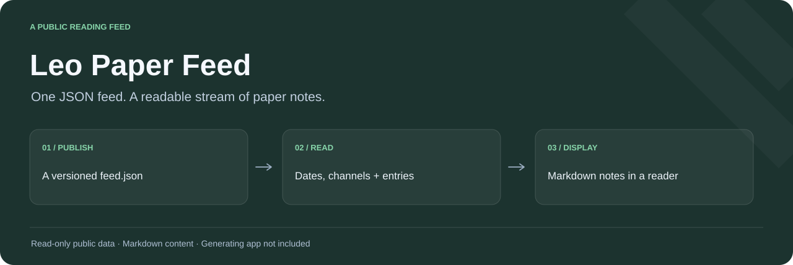
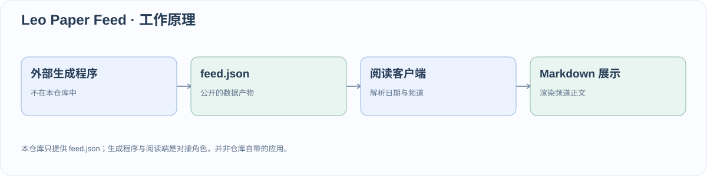

<div align="center">



# Leo Paper Feed · 论文精读笔记数据源

**一个可追溯版本的论文笔记发布面，交给阅读端直接消费。**

[](feed.json)

**中文** · [English](README_EN.md)

[读取](#直接读取) · [数据契约](#数据契约) · [阅读端对接](#接到自己的阅读端) · [本地查看](#本地查看)

</div>

面向论文读者和阅读器开发者：直接[读取最新 JSON](https://raw.githubusercontent.com/dubianche123/leo-paper-feed/main/feed.json)，或按下方示例接入自己的阅读端，无需部署服务。

这是 Leo 论文精读 App 的公开数据源。核心入口只有一个文件：**[feed.json](feed.json)**。笔记按日期和频道组织，提供 Markdown 正文，部分频道另外提供结构化条目摘要。

它可以作为阅读数据源、轻量接入示例，也可以配合提交历史检查每次发布变化。生成程序、调度器和原阅读 App 的源码不在本仓库中。

## 直接读取

[打开原始 JSON](https://raw.githubusercontent.com/dubianche123/leo-paper-feed/main/feed.json) · [查看当前文件](feed.json) · [发布历史](https://github.com/dubianche123/leo-paper-feed/commits/main/feed.json)

读取公开文件不需要 GitHub Token。`main` 地址随发布更新；需要固定历史快照时，从文件历史取得对应提交的永久链接。

## 数据契约



以下展示结构，日期、标识和正文都是占位内容，不是实际论文摘要的摘录。

```json
{
  "days": [
    {
      "date": "YYYY-MM-DD",
      "model": "source-label",
      "channels": [
        {
          "id": "01",
          "title": "Reading theme / 阅读主题",
          "content": "# Example title\n\nMarkdown body with [a link](https://example.org).",
          "items": [
            {"title": "Example item", "summary": "Short summary", "pickId": "opaque-id"}
          ]
        }
      ]
    }
  ]
}
```

| 路径 | 类型 | 阅读端怎样使用 |
| --- | --- | --- |
| `days` | 数组 | 遍历日期块，不写死天数。 |
| `days[].date` | 字符串 | 展示发布数据携带的日期。 |
| `days[].model` | 字符串 | 保留原始模型/来源标识；这是元数据，不是供应商 API 配置。 |
| `days[].channels` | 数组 | 生成这个日期下的频道列表。 |
| `channels[].id`、`.title` | 字符串 | 频道标识与名称；将日期和 ID 一起保留。 |
| `channels[].content` | 字符串 | 渲染完整的 Markdown 阅读正文。 |
| `channels[].items` | 可选数组 | 补充结构化摘要；当前数据允许没有这个数组。 |
| `items[].title`、`.summary`、`.pickId` | 字符串 | 展示条目信息，保留 `pickId` 作为不透明标识。 |

`content` 与 `items` 的职责不同。即使没有 `items`，阅读端仍可通过 `content` 展示完整频道。不要把条目摘要拼接成正文，也不要从 `pickId` 猜测论文 URL。

## 接到自己的阅读端

下面的适配函数获取文件并返回规整后的频道记录，不假定每天都有相同频道，也不假定每个频道都有 `items`。

```javascript
const FEED_URL = "https://raw.githubusercontent.com/dubianche123/leo-paper-feed/main/feed.json";

async function loadReadingChannels(url = FEED_URL) {
  const response = await fetch(url);
  if (!response.ok) throw new Error(`Feed HTTP ${response.status}`);
  const feed = await response.json();
  if (!Array.isArray(feed.days)) throw new Error("Expected feed.days array");

  return feed.days.flatMap(day =>
    (Array.isArray(day.channels) ? day.channels : []).map(channel => ({
      date: day.date,
      model: day.model,
      id: channel.id,
      title: channel.title,
      markdown: typeof channel.content === "string" ? channel.content : "",
      items: Array.isArray(channel.items) ? channel.items : [],
    }))
  );
}

const channels = await loadReadingChannels();
console.log(channels.map(({ date, id, title }) => ({ date, id, title })));
```

将返回的 `title`、`date` 和 `markdown` 接到阅读组件。Markdown 渲染与链接处理留在阅读端；正文可能包含标题、列表和外部链接。确实存在且适合展示时，再使用 `items` 渲染条目卡片。

这个入口是**静态 JSON 文件**，没有服务端分页、日期筛选或查询 API。刷新、加载/错误状态、搜索和本地缓存由消费端实现；如果希望短暂读取失败时还能继续阅读，可以保留上一次成功载入的数据。

## 本地查看

只用 Python 标准库即可检查实际日期与频道结构：

```bash
git clone https://github.com/dubianche123/leo-paper-feed.git
cd leo-paper-feed
python3 - <<'PYTHON'
import json
from pathlib import Path
feed = json.loads(Path("feed.json").read_text(encoding="utf-8"))
for day in feed.get("days", []):
    print(day.get("date"), day.get("model"))
    for channel in day.get("channels", []):
        print(" ", channel.get("id"), channel.get("title"),
              "items:", len(channel.get("items", [])))
PYTHON
```

| 目标 | 入口 |
| --- | --- |
| 读取最新发布笔记 | [feed.json](feed.json) |
| 检查某次发布改了什么 | [文件历史](https://github.com/dubianche123/leo-paper-feed/commits/main/feed.json) |
| 开发消费端 | 上面的字段契约与适配函数 |
| 运行生成程序或构建原 App | 这两个组件位于仓库之外 |

## 范围

笔记内容和频道布局会随发布变化。以上契约说明当前提供的数据结构；这个纯数据仓库没有正式的 schema 版本协商或服务可用性保证。本 README 不替笔记内容声明软件许可证。
