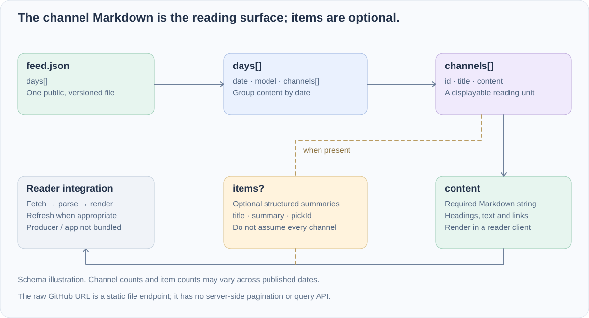

<div align="center">


# Leo Paper Feed

**A small, readable JSON contract for published paper notes.**

[中文](README.md) · **English**

[Read](#read-the-feed) · [Contract](#data-contract) · [Local inspection](#inspect-locally)

</div>

A public data source for Leo's paper-reading app. This repository supplies [feed.json](feed.json); the generating pipeline and reader application are not included. Content is grouped by date and channel, with Markdown bodies for a reader to display.

## Data flow



## Read the feed

[Raw JSON](https://raw.githubusercontent.com/dubianche123/leo-paper-feed/main/feed.json) · [Browse current data](feed.json)

```javascript
const response = await fetch("https://raw.githubusercontent.com/dubianche123/leo-paper-feed/main/feed.json");
if (!response.ok) throw new Error(`Feed HTTP ${response.status}`);
const feed = await response.json();

for (const day of feed.days ?? []) {
  for (const channel of day.channels ?? []) {
    console.log(day.date, channel.id, channel.title);
    // Render channel.content with your Markdown component.
  }
}
```

No GitHub token is required. The URL serves a versioned static file, not a backend with pagination or query filters.

## Data contract

Illustrative shape; titles and content below are placeholders:

```json
{
  "days": [{
    "date": "YYYY-MM-DD",
    "model": "source-label",
    "channels": [{
      "id": "01", "title": "Reading theme",
      "content": "# Example\n\nMarkdown content",
      "items": [{"title": "Example", "summary": "Summary", "pickId": "example-id"}]
    }]
  }]
}
```

| Field | Type | Meaning |
| --- | --- | --- |
| `days` | array | Date-grouped content blocks |
| `date` | string | Date carried by the block |
| `model` | string | The supplied model identifier; preserve its value |
| `channels` | array | Channels for this date block |
| `id`, `title` | string | Channel identifier and display title |
| `content` | string | Markdown body |
| `items` | optional array | Some channels supply item summaries with `title`, `summary`, and `pickId` |

Treat `items` as optional and do not assume a fixed number of days, channels or entries.

## Inspect locally

```bash
git clone https://github.com/dubianche123/leo-paper-feed.git
cd leo-paper-feed
python3 -c 'import json; d=json.load(open("feed.json")); print([(r["date"], len(r.get("channels", []))) for r in d.get("days", [])])'
```

## Scope

This is a read-only public data distribution. The producer, scheduling setup and app build are outside this repository. Contents change with publication updates; clients handle refreshing, missing fields, Markdown rendering and links.
